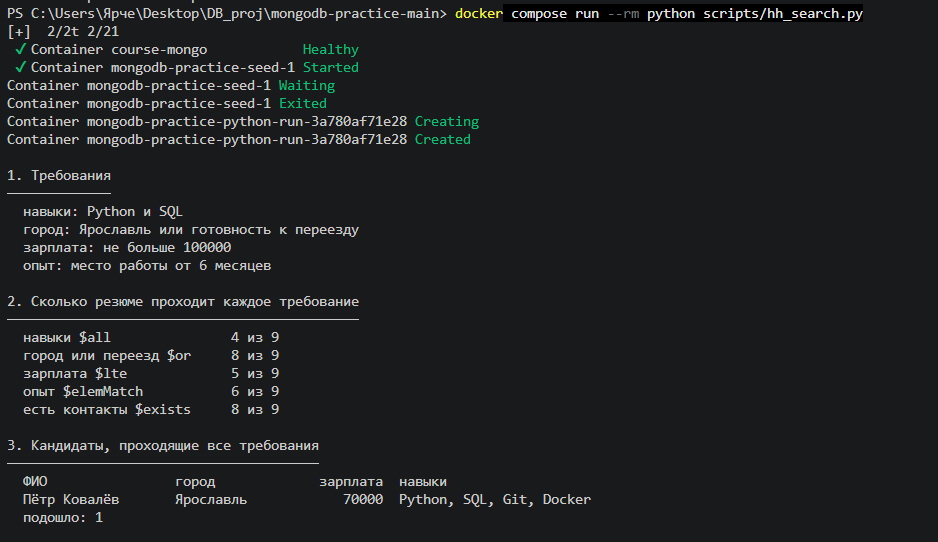
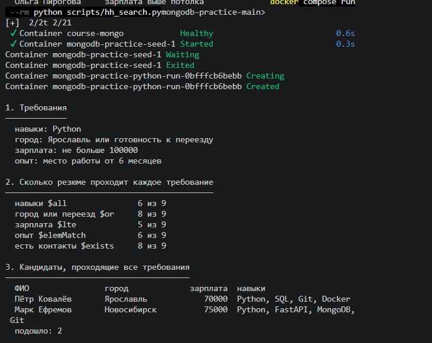
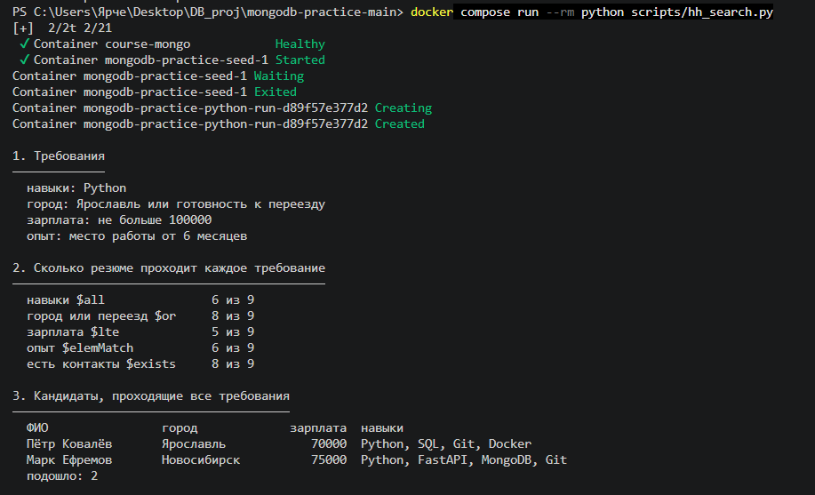
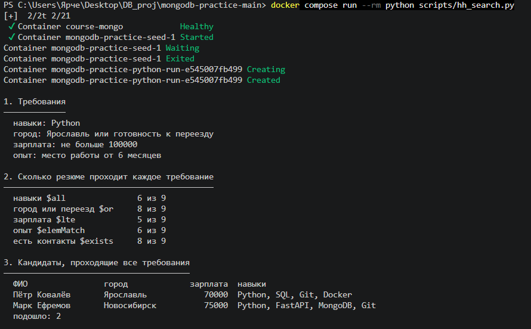
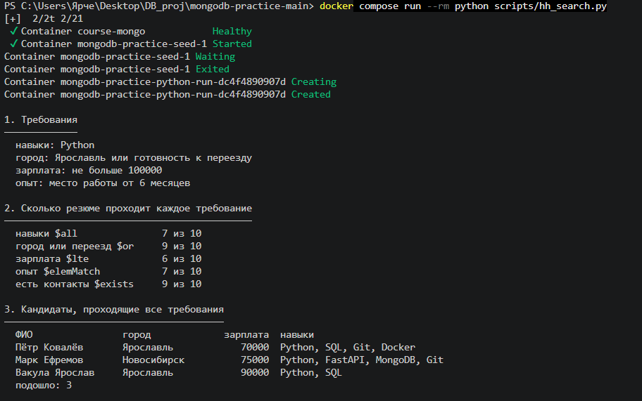

# Домашнее задание № 5. Подбор кандидатов с помощью MongoDB

## 1. Цель работы

Изучить скрипт `hh_search.py`, проанализировать работу критериев подбора
кандидатов, изменить требования по одному параметру за раз, добавить
собственное резюме и определить, какое требование можно ослабить для
получения не менее трёх подходящих кандидатов.

## 2. Исходные требования

В исходном запуске скрипта указаны следующие параметры:

  Параметр                Значение
  ----------------------- -------------------------------------
  Навыки                  `Python` и `SQL`
  Город                   Ярославль или готовность к переезду
  Максимальная зарплата   100 000
  Опыт                    не менее 6 месяцев

В исходном наборе данных было 9 резюме. Каждое изменение проверялось
отдельно, чтобы оценить влияние конкретного критерия на результат.

## 3. Результаты экспериментов

### 3.1. Исходный запуск

При исходных требованиях скрипт нашёл одного подходящего кандидата ---
Петра Ковалёва.

  Критерий                            Подходящих резюме
  --------------------------------- -------------------
  Навыки `$all`                                  4 из 9
  Город или переезд `$or`                        8 из 9
  Зарплата `$lte`                                5 из 9
  Опыт `$elemMatch`                              6 из 9
  Наличие контактов `$exists`                    8 из 9
  **Одновременно все требования**                 **1**

### 3.2. Изменение навыков

В этом запуске список навыков был изменён с `Python` и `SQL` на один
навык --- `Python`. Остальные требования оставались прежними.

Число резюме, проходящих проверку навыков, увеличилось с 4 до 6 из 9. В
разделе подходящих кандидатов отображаются Пётр Ковалёв и Марк Ефремов;
всего подошли 2 кандидата.

  Критерий                            Подходящих резюме
  --------------------------------- -------------------
  Навыки `$all` (только Python)                  6 из 9
  Город или переезд `$or`                        8 из 9
  Зарплата `$lte`                                5 из 9
  Опыт `$elemMatch`                              6 из 9
  Наличие контактов `$exists`                    8 из 9
  **Одновременно все требования**                 **2**

### 3.3. Изменение максимальной зарплаты

В этом эксперименте требования к навыкам, городу и опыту оставались
исходными. На скриншоте показано значение потолка зарплаты `100000`;
число кандидатов в разделе 3 --- 2. Это изображение само по себе не
показывает изменение зарплатного параметра относительно исходного
запуска, поэтому ниже зафиксирован именно видимый результат.

  Критерий                            Подходящих резюме
  --------------------------------- -------------------
  Навыки `$all`                                  6 из 9
  Город или переезд `$or`                        8 из 9
  Зарплата `$lte`                                5 из 9
  Опыт `$elemMatch`                              6 из 9
  Наличие контактов `$exists`                    8 из 9
  **Одновременно все требования**                 **2**

### 3.4. Изменение опыта

На скриншоте параметры отображаются как `Python`, Ярославль или
готовность к переезду, зарплата до `100000`, опыт от 6 месяцев. В
разделе 2 показаны результаты для 10 резюме, а в разделе 3 найдено 3
кандидата: Пётр Ковалёв, Марк Ефремов и Вакула Ярослав.

  Критерий                            Подходящих резюме
  --------------------------------- -------------------
  Навыки `$all`                                 7 из 10
  Город или переезд `$or`                       9 из 10
  Зарплата `$lte`                               6 из 10
  Опыт `$elemMatch`                             7 из 10
  Наличие контактов `$exists`                   9 из 10
  **Одновременно все требования**                 **3**

> Примечание: на этом скриншоте в видимых требованиях указано «опыт:
> место работы от 6 месяцев». Новое значение опыта не отображается,
> поэтому по одному скриншоту нельзя достоверно определить, какое именно
> значение было изменено.

## 4. Собственное резюме

На последнем скриншоте число резюме увеличилось с 9 до 10. В списке
подходящих кандидатов появился Вакула Ярослав с городом Ярославль,
зарплатой 90000 и навыками `Python, SQL`. Всего программа нашла 3
подходящих резюме.

  Поле                          Значение, видимое на скриншоте
  ----------------------------- --------------------------------
  ФИО                           Вакула Ярослав
  Город                         Ярославль
  Зарплата                      90 000
  Навыки                        Python, SQL
  Число резюме в базе           10
  Всего подходящих кандидатов   3

Таким образом, добавленное резюме отображается в списке кандидатов,
которые проходят требования скрипта.

## 5. Разбор разделов скрипта

  -------------------------------------------------------------------------
                      № Раздел           Назначение        Основные
                                                           операторы и
                                                           конструкции
  --------------------- ---------------- ----------------- ----------------
                      1 Требования       Вывод параметров  Значения
                                         поиска            переменных
                                                           скрипта

                      2 Проверка         Подсчёт резюме,   `$all`, `$or`,
                        отдельных        проходящих каждый `$lte`,
                        требований       критерий по       `$elemMatch`,
                                         отдельности       `$gte`,
                                                           `$exists`

                      3 Подходящие       Поиск резюме,     `$all`, `$lte`,
                        кандидаты        одновременно      `$elemMatch`,
                                         соответствующих   `$gte`, `$or`
                                         основным          
                                         требованиям       

                      4 Вакансии Junior  Поиск названий    `$regex`,
                                         должностей,       `$options`
                                         начинающихся с    
                                         `junior`          

                      5 Вакансии по      Проверка          `$lte`, `$gte`
                        зарплате         зарплатного       
                                         диапазона         
                                         вакансии          
                                         относительно      
                                         ожидаемой         
                                         зарплаты 90000    

                      6 Собеседования    Поиск             `$gte`, `$lt`
                                         собеседований в   
                                         заданном          
                                         временном         
                                         диапазоне         

                      7 Проверка         Поиск пропущенных `$exists`,
                        качества данных  и некорректных    `$not`, `$type`,
                                         значений          `$size`,
                                                           `$expr`, `$gt`,
                                                           `$ne`

                      8 Причины отказа   Анализ причин, по `if`, `not`,
                                         которым резюме не `and`, `or`,
                                         проходят          `set` в Python
                                         требования        
  -------------------------------------------------------------------------

### Краткое описание операторов

-   `$all` --- массив содержит все перечисленные значения.
-   `$or` --- достаточно выполнения хотя бы одного условия.
-   `$lte` --- значение меньше или равно заданному.
-   `$gte` --- значение больше или равно заданному.
-   `$elemMatch` --- поиск элемента массива, который удовлетворяет
    указанным условиям.
-   `$exists` --- проверка наличия поля.
-   `$regex` --- поиск по регулярному выражению.
-   `$options: "i"` --- поиск без учёта регистра.
-   `$lt` --- значение строго меньше заданного.
-   `$not` --- отрицание условия.
-   `$type` --- проверка типа значения.
-   `$size` --- проверка размера массива.
-   `$expr` --- использование выражений при сравнении полей.
-   `$gt` --- значение строго больше заданного.
-   `$ne` --- значение не равно заданному.

## 6. Какое требование следует ослабить

Цель задания --- получить не менее трёх кандидатов. Запуск с одним требованием к навыкам (`Python`) даёт 2
кандидата, а запуск после добавления собственного резюме даёт 3
кандидата.

Наиболее очевидный вывод: расширение списка
допустимых навыков с `Python` и `SQL` до одного `Python` увеличило число
подходящих кандидатов с 1 до 2. Однако одного этого изменения
недостаточно для достижения трёх кандидатов.

На последнем испынии найдено 3 кандидата после добавления собственного
резюме. Поэтому нельзя утверждать, что изменение потолка зарплаты или
опыта само по себе привело к трём кандидатам: видимые значения этих
параметров на скриншотах не позволяют уверенно подтвердить такое
сравнение.

**Вывод:** для окончательного подтверждения выбранного требования
необходимо выполнить отдельный повторный запуск, изменив только один
параметр, и сохранить вывод, где видно новое значение в разделе 1 и
итоговое число кандидатов в разделе 3.

## 7. Итоговый вывод

В ходе работы был запущен скрипт `hh_search.py` в Docker-контейнере. При
исходных требованиях найден 1 кандидат. При изменении навыков на один
навык `Python` найдено 2 кандидата. После добавления собственного резюме
число записей в базе увеличилось с 9 до 10, а число подходящих
кандидатов --- до 3. В списке кандидатов отображается Вакула Ярослав с
зарплатой 90000 и навыками `Python, SQL`.
Скриншоты показывают ход экспериментов и результат добавления
собственного резюме.

